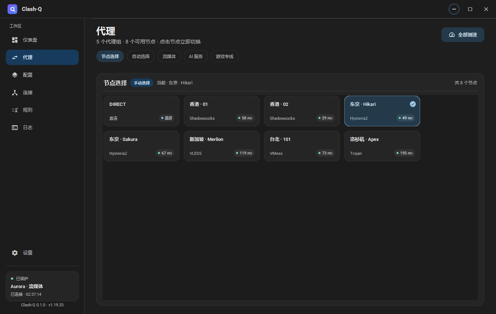
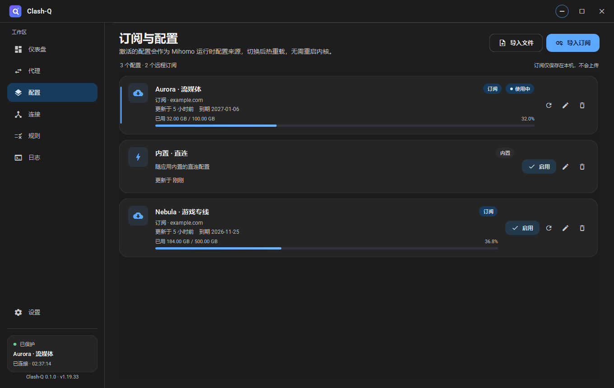
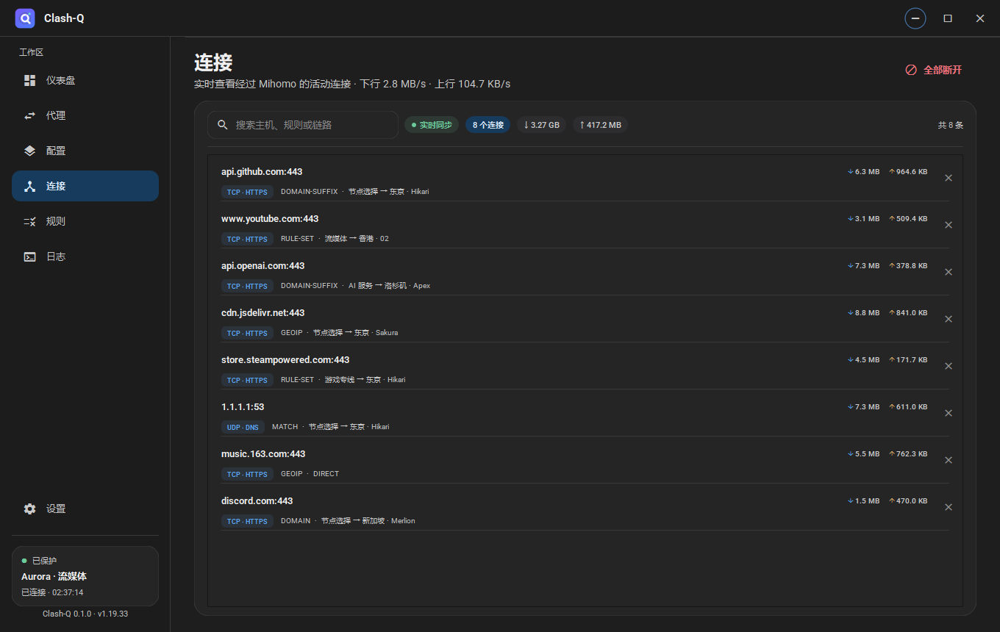
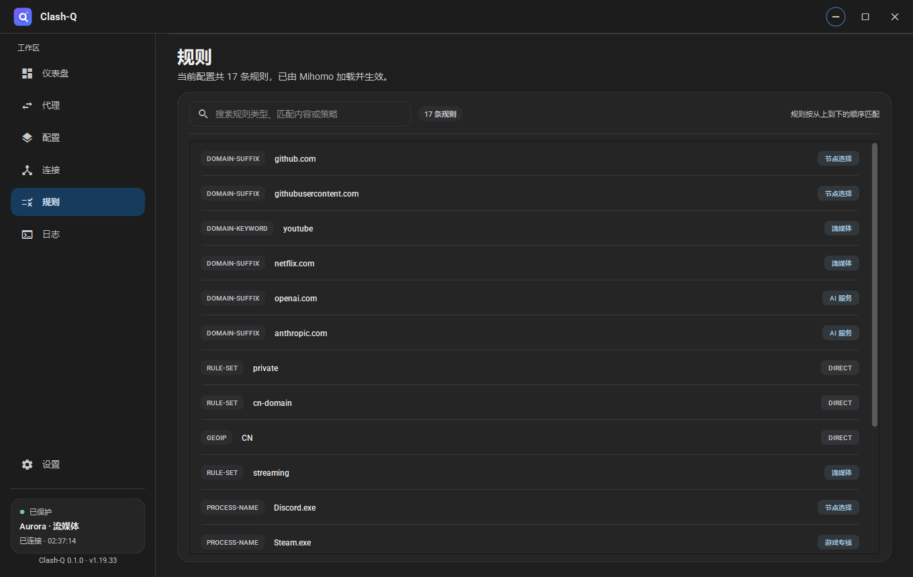
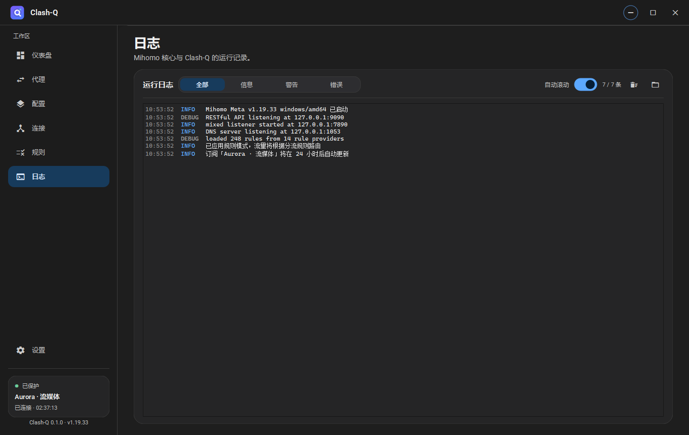
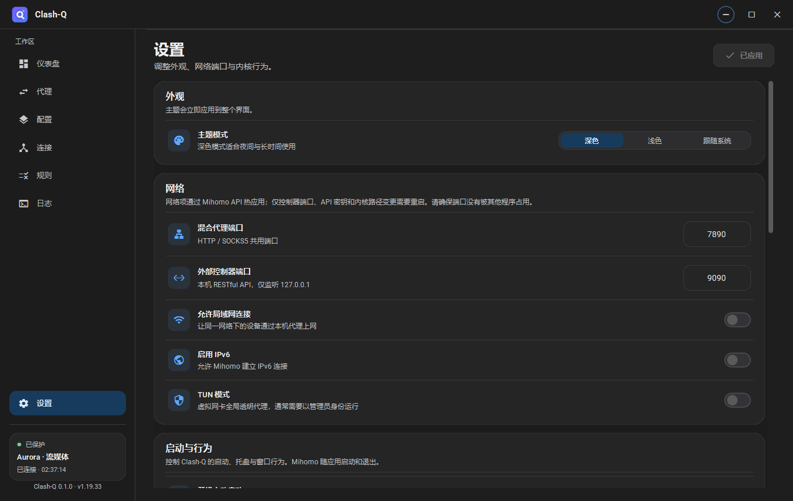
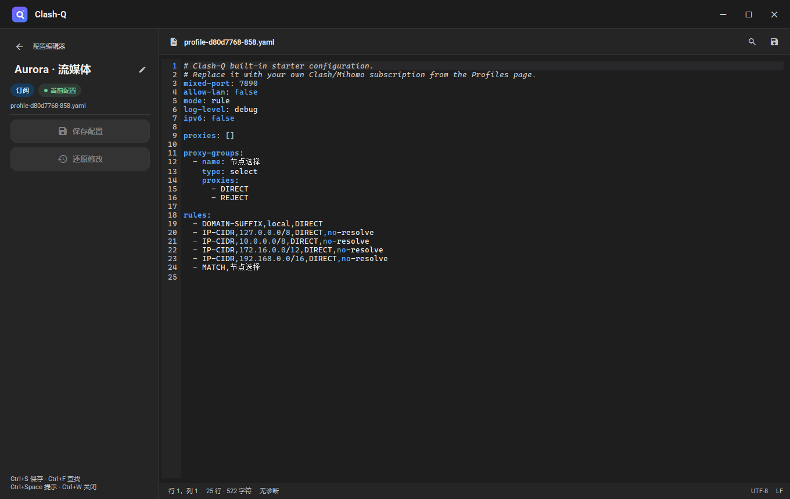

# Clash-Q

<div align="center">
  
  <h1>Clash-Q</h1>
  <p><strong>Material Design 3 · Mihomo 内核 · Qt 6.12.0 · C++20</strong></p>
  <p>一款面向 Windows 的轻量 Clash / Mihomo 桌面客户端，使用自绘 Material 组件与真实 Mihomo RESTful API。</p>
</div>

---


## 特性

### 真实内核，不做“假仪表盘”

- 以独立子进程方式启动 **Mihomo v1.19.33**，随 UI 进程启动和退出；启动参数和运行时配置由客户端生成。
- 通过本机 `127.0.0.1` RESTful API 获取版本、代理组、连接、规则、流量与配置。
- 支持规则、全局、直连三种模式，代理组节点切换与延迟测速。
- 实时流量图、本次会话上下行总量、连接列表与规则列表。
- 实际可用的系统代理开关（读写 Windows `Internet Settings`，退出时恢复原设置）。
- TUN 模式开关，随包附带 `wintun.dll`；以管理员身份运行时可创建虚拟网卡。
- 仪表盘采用三行网格：实时流量与内存信息；网络出口、内核连接与服务状态；
  活动连接与当前配置。
- 网络出口卡片显示 **IP、国家/地区与 ISP**；代理模式作为独立卡片放在其下方。
- 内核卡片顶部显示可复制、可选中的本机内网 IP；下方仅保留系统代理、TUN 与
  局域网代理三个开关。
- 内存信息卡片用实时曲线展示 **Clash-Q 与 Mihomo 的工作集内存**；服务状态卡片
  展示 GitHub / Google / YouTube 的连接延迟。
- 活动连接卡片是实时连接列表，支持滚动和断开单条连接；配置卡片通过右上角箭头
  跳转配置页，并展示当前配置、来源、到期时间、自动更新、文件、更新时间与流量配额。
- 出口信息经当前混合端口访问 `ipwho.is`（中文返回，失败时回退 Cloudflare trace）；
  网站延迟使用轻量 HEAD 请求经当前节点探测；探测结果不写入日志。

### 订阅与配置

- 导入 Clash / Mihomo YAML 订阅或本地 YAML 文件。
- 下载时自动读取 `subscription-userinfo`、`profile-title`、`profile-update-interval` 响应头。
- 展示流量配额、到期时间、更新时间和订阅地址来源。
- 订阅更新、删除、启用；激活配置后通过 Mihomo 的 `PUT /configs?force=true`
  热重载运行时配置，不需要重启内核进程。
- **全窗口配置编辑器**：除标题栏外占满窗口，左侧为文件操作与可编辑的配置名称，
  右侧为完整代码编辑区；行号、当前行、括号匹配、查找替换、多行缩进、未保存保护。
- 通过标准 **LSP（Language Server Protocol）** 接入开源
  [yaml-language-server](https://github.com/redhat-developer/yaml-language-server)：
  代码提示、LSP 诊断（波浪线）、文档格式化均由语言服务器完成，不再由客户端自行实现。
- 语言服务器以独立 stdio 子进程运行，发布包内置 Node.js 与 YAML Language Server；
  `lsp-servers.json` 可新增或替换服务配置，按扩展名自动选择。
- 支持可选的当前订阅自动更新（关闭 / 6 / 12 / 24 小时）。
- 订阅内容只保存在本机；不经过任何第三方服务。

### Material 3 桌面体验

- 深色、浅色、跟随系统主题，完整重绘的 Material 3 配色。
- 深色模式参考 Visual Studio 2026 的中性灰表面（#1E1E1E / #1C1C1C / #252526 /
  #2D2D30），使用蓝色强调色与琥珀色辅助图表，图标徽章统一为蓝色系；
  不使用紫色主调和绿色图标。
- 自绘胶囊按钮、Icon Button、Switch、Segmented Control、Filter Chip、Pill、Card、Progress、Snackbar。
- 无边框窗口、Windows 11 DWM 圆角、四边拖拽缩放、自定义标题栏。
- QToolTip 与托盘右键菜单在 Windows 11 上使用 DWM 圆角窗口（带抗锯齿）；
  旧系统回退为圆角窗口蒙版，避免圆角样式外残留直角原生窗口背景。
- Material 3 细滚动条：透明轨道、8px 圆角滑块、无上下箭头，悬停/按压使用现有主题色。
- 托盘右键菜单显式应用 Material 菜单样式，避免在应用主题样式表之前创建菜单时回退为原生 Fusion 样式。
- 动态流量图、平滑控件动画、圆角导航栏与分层背景。
- 系统托盘：显示主窗口、模式切换、系统代理、TUN 与退出。
- 单实例运行（重复启动会唤起已有窗口）。
- Mihomo 内核生命周期与 UI 进程一致：应用启动后自动启动内核，退出时优雅关闭；
  手动重启仅保留在设置页的「内核」区域。
- 开机启动、启动时最小化、关闭到托盘。

## 界面

| 代理节点 | 订阅管理 |
| --- | --- |
|  |  |

| 实时连接 | 规则列表 |
| --- | --- |
|  |  |

| 运行日志 | 设置 |
| --- | --- |
|  |  |

浅色主题：


全窗口配置编辑器（左侧操作区、右侧代码区、内置 YAML LSP）：



## LSP 语言服务

编辑器自身不包含补全、格式化或语言诊断实现。它启动一个标准 LSP stdio
子进程，并发送 `initialize`、`textDocument/didOpen`、`didChange`、`completion`、
`formatting` 等标准请求。

发布包内置：

- Node.js 22（`lsp/node.exe`）
- [yaml-language-server 2.0.0](https://github.com/redhat-developer/yaml-language-server)（`lsp/yaml-language-server`）

服务配置位于程序目录的 `lsp-servers.json`。可复制
`lsp-servers.example.json` 后修改；按文件扩展名选择服务，`servers` 数组中
同 `id` 的条目会覆盖内置配置。例如：

```json
{
  "servers": [
    {
      "id": "yaml",
      "name": "YAML Language Server",
      "languageId": "yaml",
      "extensions": ["yaml", "yml"],
      "command": "${app}/lsp/node.exe",
      "args": [
        "${app}/lsp/yaml-language-server/node_modules/yaml-language-server/out/src/server.js",
        "--stdio"
      ],
      "initializationOptions": {
        "yaml": { "validate": true, "hover": true, "completion": true,
                  "format": { "enable": true } }
      }
    }
  ]
}
```

编辑器界面不展示 LSP 服务状态；诊断仍以波浪线标出，错误/警告数量显示在底部状态栏。
按 `Shift+Alt+F` 可调用 LSP 格式化文档。

## 技术栈

| 层 | 实现 |
| --- | --- |
| 语言 | C++20 |
| 构建 | CMake 3.21+，MSVC 2022 x64 |
| 编辑器 | `QPlainTextEdit` 自绘行号 / 当前行 / 诊断波浪线，VSCode 风格快捷键 |
| 语言服务 | 通用 LSP stdio 客户端 + `yaml-language-server` 2.0.0（Node.js 22） |
| 语言配置 | `lsp-servers.json` 服务描述，按扩展名组合 / 替换 |
| UI | Qt 6.12.0 Widgets，自绘 Material 3 组件 |
| 网络 | Qt Network（RESTful API、订阅下载） |
| 进程 | QProcess 管理 Mihomo 子进程 |
| 内核 | Mihomo v1.19.33（独立可执行文件） |
| TUN | Wintun 0.14.1 |

## 构建

### 环境

- Windows 10 / 11 x64
- Qt **6.12.0** `msvc2022_64`
- Visual Studio 2022（MSVC v143，C++ 桌面开发工作负载）
- CMake 3.21 或更高版本

仓库已经在 `third_party/mihomo/` 放置了 Mihomo 与 Wintun，无需额外下载内核。

### 命令行

```powershell
$QtDir = "D:\Qt\6.12.0\msvc2022_64"

cmake -S . -B build -G "Visual Studio 17 2022" -A x64 `
  -DCMAKE_PREFIX_PATH="$QtDir" `
  -DBUILD_TESTING=ON

cmake --build build --config Release --parallel
ctest --test-dir build -C Release --output-on-failure
```

产物位于 `build\Release\Clash-Q.exe`，构建后会自动把 `mihomo.exe` 和
`wintun.dll` 复制到同一目录。

### 运行

直接运行 `build\Release\Clash-Q.exe` 需要 Qt 的 DLL 在 `PATH` 中。更推荐部署
Qt 运行时：

```powershell
cmake --build build --config Release --target deploy
.\build\Release\Clash-Q.exe
```

或制作可分发目录/zip：

```powershell
.\scripts\package.ps1 -QtDir "D:\Qt\6.12.0\msvc2022_64"
```

生成：

- `dist\Clash-Q\`：可直接运行的完整目录
- `dist\Clash-Q-0.1.0-win64.zip`：分发包

### Qt Creator

用 Qt Creator 打开根目录的 `CMakeLists.txt`，选择 Qt 6.12.0 MSVC 2022 64bit
套件即可。确保构建后的可执行文件目录里有 `mihomo.exe`、`wintun.dll` 和 Qt DLL。

## 首次使用

1. 首次启动会创建一个 **内置 · 直连** 配置，可直接体验界面。
2. 打开 **订阅** → **导入订阅**，粘贴 Clash 格式的订阅地址；或使用 **导入文件**。
3. 导入成功后配置会自动启用。
4. 内核随应用启动，回到 **仪表盘** 即可查看流量与出口状态。
5. 如需全局接管 Windows 流量：
   - 打开 **系统代理**（自动写入当前用户代理设置，断开/退出时恢复）；或
   - 以管理员身份运行后打开 **TUN 模式**（需要创建虚拟网卡，依赖随包 Wintun）。
6. 在 **代理** 页选择节点；右键或双击节点测速；在 **连接**、**规则**、**日志** 页查看运行状态。
7. 在 **配置** 页点击每张配置卡片右侧的铅笔图标，可直接编辑 YAML；保存后若该配置正在使用，
   会通过 Mihomo API 热重载，进程保持运行。远程订阅的手动修改会被之后的订阅更新覆盖。

> 系统代理修改的是当前用户的 Windows Internet Settings；Clash-Q 会在应用退出时
> 恢复首次启用前的设置。若进程被强制结束，请手动检查“设置 → 网络和 Internet →
> 代理”。

## 快捷键

| 快捷键 | 功能 |
| --- | --- |
| `Ctrl+1` … `Ctrl+6` | 切换仪表盘 / 代理 / 订阅 / 连接 / 规则 / 日志 |
| `Ctrl+7` 或 `Ctrl+,` | 打开设置 |
| `Ctrl+Q` | 退出 Clash-Q |
| 编辑器内 `Ctrl+S` | 保存并应用配置 |
| 编辑器内 `Ctrl+F` / `Ctrl+H` | 查找 / 查找替换 |
| 编辑器内 `F3` / `Shift+F3` | 下一个 / 上一个匹配 |
| 编辑器内 `Ctrl+/` | 切换行注释 |
| 编辑器内 `Alt+↑` / `Alt+↓` | 上移 / 下移当前行 |
| 编辑器内 `Shift+Alt+F` | 调用 LSP 格式化文档 |
| 编辑器内 `Ctrl+Space` | 调用 LSP 代码提示 |
| 编辑器内 `Ctrl+W` | 关闭编辑器 |

## 数据目录

默认数据目录：

```text
%LOCALAPPDATA%\Clash-Q\
```

结构：

```text
Clash-Q/
├─ settings.ini            应用设置（端口、主题、行为、控制器密钥）
├─ instance.lock            单实例锁
├─ clash-q.log              应用与内核日志（启动时轮转）
├─ profiles/
│  ├─ profiles.json         订阅元数据、激活项
│  └─ profile-*.yaml        原始订阅 / 本地配置快照
├─ runtime/
│  ├─ config.yaml           由客户端净化的运行时配置
│  └─ core.log
└─ ...
```

便携模式：在 `Clash-Q.exe` 同目录放入空文件 `portable.flag`，数据目录改为
`.\data`。也可以用环境变量覆盖：

```powershell
$env:CLASHQ_DATA_DIR = "D:\ClashQData"
.\Clash-Q.exe
```

## 安全设计

- **控制器认证**：首次启动生成 24 字节随机密钥（48 位十六进制字符串），
  每次请求通过 `Authorization: Bearer <secret>` 发送；外部控制器只监听
  `127.0.0.1`。
- **运行时配置净化**：订阅中的 `external-controller`、`secret`、端口、
  `allow-lan`、`mode`、`tun` 等顶层字段会被 Clash-Q 重写，避免订阅远程
  暴露控制器或改变本地端口。
- **系统代理恢复**：启动前捕获当前用户代理设置，关闭/退出时恢复；不修改
  机器级设置，不需要管理员权限。
- **最小权限**：默认不启用 TUN；TUN 需要用户显式开启并通常需要管理员权限。
- **本机存储**：订阅文件可能包含节点密码、UUID 等敏感信息，以明文保存在
  当前用户数据目录。请保护好 Windows 账户与数据目录。
- 本项目不会将订阅、连接或日志上传到任何服务器。

## 架构

```text
┌────────────────────────────────────────────────────────────┐
│ MainWindow / Pages / Custom Material Widgets               │
│ Dashboard  Proxies  Profiles  Connections  Rules  Logs    │
└───────────────────────────┬────────────────────────────────┘
                            │ signals / state
┌───────────────────────────▼────────────────────────────────┐
│ ClashController                                            │
│  ├─ ProfileStore      订阅元数据、下载、激活               │
│  ├─ RuntimeConfig     生成受控运行时 YAML                  │
│  ├─ MihomoProcess     QProcess + 标准输出日志              │
│  ├─ MihomoApi         REST、流式流量、节点延迟队列         │
│  └─ SystemProxy       Windows 系统代理备份/恢复            │
└───────────────────────────┬────────────────────────────────┘
                            │ localhost HTTP + QProcess
┌───────────────────────────▼────────────────────────────────┐
│ Mihomo v1.19.33 / Wintun                                  │
└────────────────────────────────────────────────────────────┘
```

关键设计：

- `ClashController` 维护 `Stopped / Starting / Running / Stopping / Failed` 状态机，
  使用探针轮询控制器版本并设置启动超时。
- `MihomoApi` 使用 `/traffic` 流式响应绘制曲线，连接/代理/规则按 2/3/15 秒
  轮询；延迟测速最多 8 个并发任务。
- 代理组节点切换、模式切换和配置切换都通过 REST API 完成。
- 配置内容变化（编辑器保存、订阅更新、激活配置）会重新生成受控的
  `runtime/config.yaml`，再调用 Mihomo 官方的
  [`PUT /configs?force=true`](https://wiki.metacubex.one/en/api/#configs) 热重载；
  内核 PID 不变。
- 网络设置中的端口、`allow-lan`、IPv6、TUN、日志级别同样走热重载；系统代理端口
  会在重载成功后同步更新。
- 外部控制器端口、API 密钥、内核路径是进程级参数，变化时仍需重启 Mihomo 子进程。
- `NetworkProbe` 为仪表盘网络洞察提供数据：使用本地混合端口作为 HTTP 代理，
  因而不依赖 Windows 系统代理开关；出口信息每 5 分钟或节点/模式/配置变化时刷新，
  网站延迟每 60 秒刷新。
- 进程内存使用 Windows `GetProcessMemoryInfo` 读取工作集，每 2.5 秒更新一次。
- UI 层完全不直接访问注册表或内核进程；所有副作用集中到 Controller。

### 内核停止

Mihomo 的 REST API 没有 `shutdown` 接口；`/restart` 会在清理后启动一个新的内核进程，
并不等于停止。Mihomo 官方的优雅退出路径是主循环中的 `SIGINT` / `SIGTERM`，退出时会输出
`Mihomo shutting down` 并调用 `executor.Shutdown()` 清理监听器、TUN 路由和 fake-ip 状态。

Windows 下 Clash-Q 使用隐藏控制台 + `CREATE_NEW_PROCESS_GROUP` 启动内核；停止时向内核
进程组发送 `CTRL_BREAK_EVENT`。Go runtime 将其转换为中断信号，从而触发完整的优雅清理。
只有 6 秒内仍未退出时才回退为强制结束。因此日志中正常情况下应看到：

```text
正在停止 Mihomo 核心…
已请求 Mihomo 优雅退出（CTRL_BREAK_EVENT）
Mihomo shutting down
Mihomo 核心已停止
```

### 目录

```text
src/
├─ app/                 主题、字体、运行时路径
├─ core/                控制器、API、配置、订阅、进程、系统代理
├─ models/              规则与连接 QAbstractListModel / Delegate
├─ ui/
│  ├─ widgets/          Material 3 自绘控件、图表、节点与订阅卡
│  ├─ pages/            七个主页面
│  └─ dialogs/          无边框 Modal Material 对话框
└─ main.cpp             应用启动、单实例、演示/截图/冒烟测试入口
tests/                   Qt Test 单元测试
third_party/mihomo/      Mihomo 与 Wintun 二进制及其许可证
resources/              字体、图标、内置配置、qrc
```

## 开发辅助

### 演示模式

不启动真实内核，展示完整 UI 与模拟数据：

```powershell
.\build\Release\Clash-Q.exe --demo
```

### 截图

以演示模式启动，等待渲染完成后保存窗口截图并退出：

```powershell
.\build\Release\Clash-Q.exe --demo --screenshot .\docs\screenshots\dashboard.png --page dashboard
.\build\Release\Clash-Q.exe --demo --theme light --screenshot .\docs\screenshots\dashboard-light.png
.\build\Release\Clash-Q.exe --screenshot-editor .\docs\screenshots\config-editor.png
```

支持页面：`dashboard`、`proxies`、`profiles`、`connections`、`rules`、`logs`、
`settings`，也可以传 `0`–`6`。`--screenshot-editor` 会自动打开全窗口演示编辑器，
用于视觉回归。

### 真实内核冒烟测试

使用临时数据目录、随机空闲端口启动真实 Mihomo，验证：

- 运行时配置成功启动内核；
- `/version`、`/proxies`、`/rules` API 可读；
- 代理模式切换、节点切换 API 可写；
- 修改当前配置后自动热重载，新增规则立即出现在 `/rules` 中，且内核 PID 保持不变；
- 修改混合端口后通过配置热重载应用，内核 PID 仍保持不变；
- 读取应用与 Mihomo 进程的工作集内存；
- 停止时触发 Mihomo 的 `SIGINT` 清理路径，日志出现 `Mihomo shutting down`，且不触发强制终止；
- 进程能正常停止。

```powershell
.\build\Release\Clash-Q.exe --smoke-test
```

冒烟测试不会创建主窗口，因此无需设置 `QT_QPA_PLATFORM`。如果部署目录只包含
Windows 平台插件，请不要强制使用 `offscreen`，否则 Qt 会因缺少平台插件而弹出错误。

成功输出类似：

```text
SMOKE_NOTICE Mihomo 核心已连接
SMOKE_HOT_RELOAD save=1 pid=8268 error=
SMOKE_HOT_SETTINGS mixedPort=54361 applied=1 pid=8268
SMOKE_OK version=v1.19.33 groups=1 rules=7 connections=0 mode=global apiError=0 pidBefore=8268 pidAfter=8268 processStable=1 settingsHotApply=1 ruleApplied=1
SMOKE_MEMORY app=42065920 kernel=27467776 appValid=1 kernelValid=1
SMOKE_SHUTDOWN_OK gracefulLog=1 forced=0
```

### 单元测试

```powershell
ctest --test-dir build -C Release --output-on-failure
```

当前测试覆盖：

- 运行时 YAML 净化（端口、secret、Tun、DNS、原有 DNS 保留）；
- Mihomo API JSON 解析（代理组、延迟、隐藏组、连接、总量）；
- 订阅保存/重启后持久化、远程导入响应头解析、删除激活配置后的回退；
- 配置编辑器保存的内容持久化、内置配置转为本地配置，以及非法内容拒绝写入。

## 已知限制

- **Windows 优先**：系统代理与托盘针对 Windows 实现；macOS/Linux 上核心连接与
  大部分 UI 可编译，但系统代理、TUN 尚未实现。
- 仅支持 Clash / Mihomo YAML 订阅；纯 Base64 节点列表不会被自动转换。
- TUN 模式需要管理员权限；应用未安装常驻服务，因此不能从标准用户自动提权。
  若启动失败，请以管理员身份运行或关闭 TUN 后重新连接。
- 运行时配置会接管列出的网络顶层字段；高阶 YAML（如复杂 `proxy-providers`
  的本地相对路径）可能需要把依赖文件放到数据目录后再导入。
- 高级内核配置（DNS 细节、规则提供者、自定义脚本）需在订阅文件中维护。
- 界面语言目前为中文；未包含多语言切换。
- 内核二进制版本固定为 v1.19.33，升级时可替换 `third_party/mihomo/mihomo.exe`
  并重新构建。

## 第三方与许可证

- 本项目源代码：MIT（见 [LICENSE](LICENSE)）。
- MSVC x64 运行库：Microsoft Visual C++ Redistributable 许可（随包提供 DLL）。
- Qt 6.12.0：LGPL v3 / GPL v3 / 商业许可。
- Mihomo v1.19.33：GPL v3。
- Wintun 0.14.1：WireGuard LLC 预编译二进制许可。
- Roboto：SIL Open Font License 1.1。
- Material Icons：Apache License 2.0。

完整说明与许可证文件见 [THIRD_PARTY_NOTICES.md](THIRD_PARTY_NOTICES.md) 和
[`licenses/`](licenses/)。
