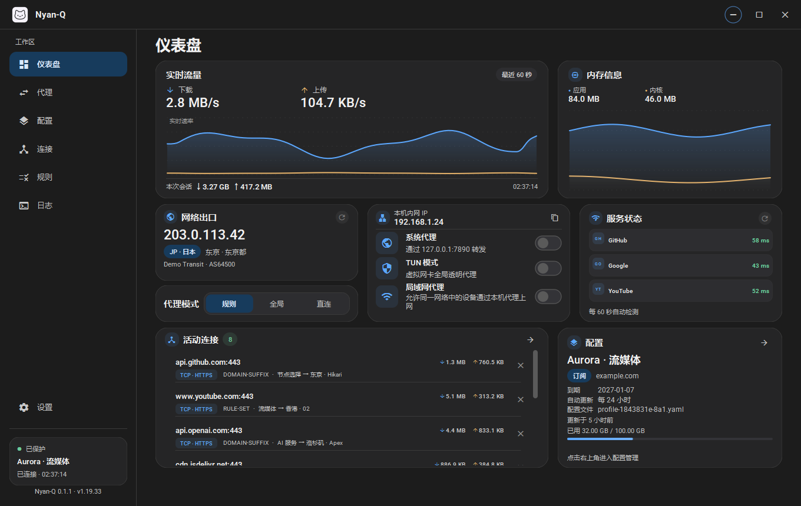
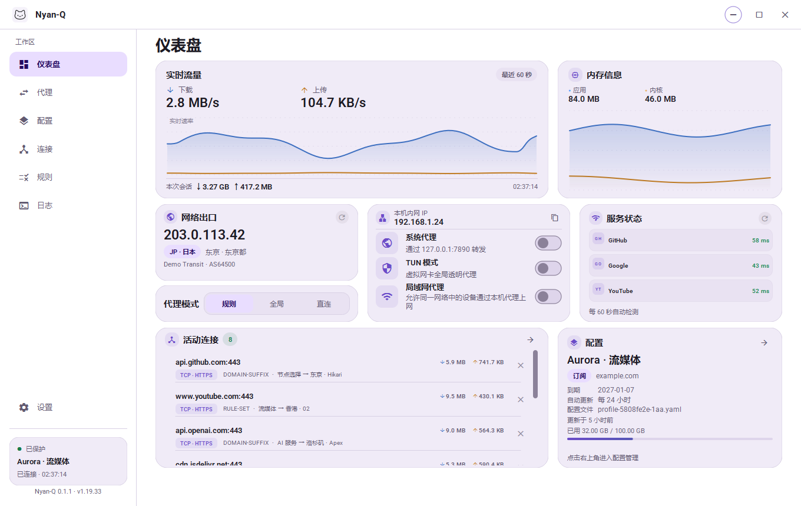
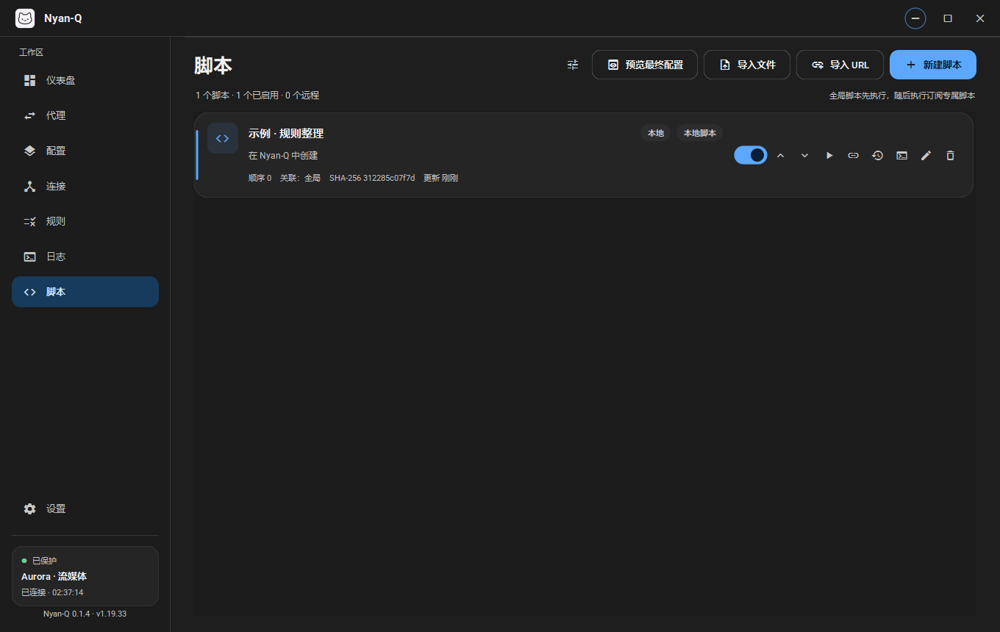
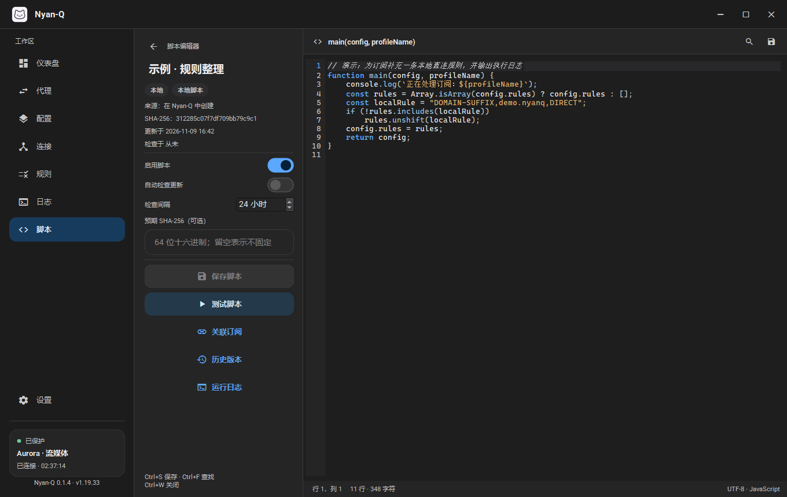
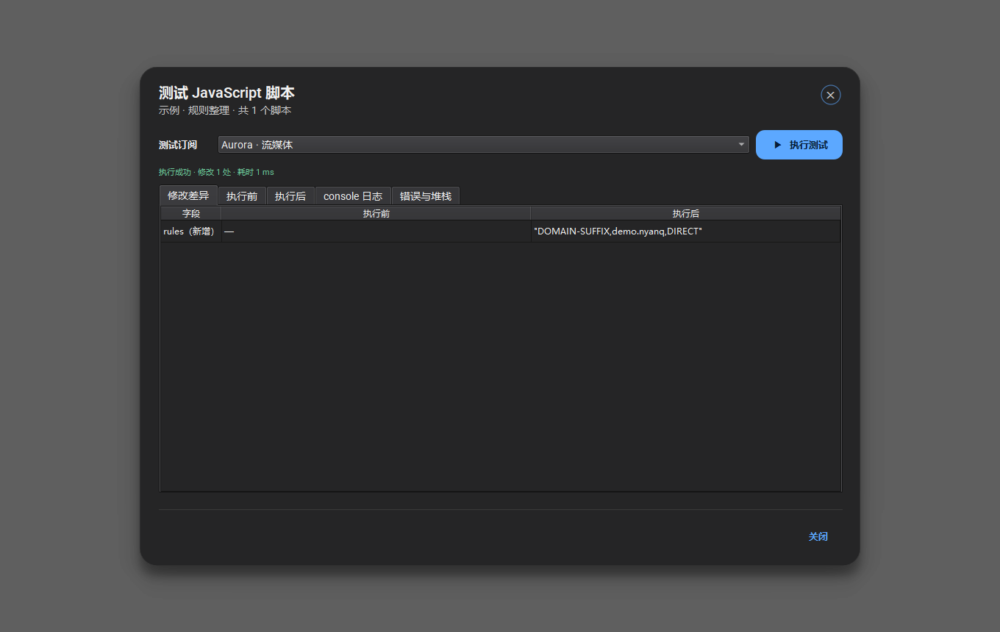

# Nyan-Q

<p align="center">
  
</p>

面向 Windows 的 Clash / Mihomo 桌面客户端，使用 Qt 6 Widgets、C++20 与
Material 3 风格组件，通过本机 REST API 管理 Mihomo 内核。

| 深色主题 | 浅色主题 |
|:---:|:---:|
|  |  |

## 功能

- Mihomo 随应用启动和退出，设置页提供重启入口
- 规则、全局、直连三种代理模式，支持代理组与节点切换、延迟测速
- 仪表盘展示实时流量、内存、网络出口、服务延迟、活动连接和当前配置
- 系统代理、TUN、局域网代理开关
- 导入 Clash / Mihomo YAML 订阅或本地文件，支持配额、到期时间、自动更新和热重载
- 全窗口 YAML 编辑器，支持查找替换、未保存保护、配置重命名
- 内置语言插件为 YAML 与 JavaScript 提供语法高亮、语法检查和代码提示，无外部 LSP 进程
- JavaScript 配置覆写：QuickJS 独立沙箱、全局/订阅专属脚本、排序、远程脚本更新、历史版本与回滚、预览差异
- 深色 / 浅色 / 跟随系统主题
- 系统托盘、单实例、开机启动、启动时最小化、关闭到托盘

## 构建

环境：

- Windows 10 / 11 x64
- Qt 6.12.0 `msvc2022_64`
- Visual Studio 2022（MSVC v143）
- CMake 3.21+

```powershell
$QtDir = "D:\Qt\6.12.0\msvc2022_64"

.\scripts\fetch-deps.ps1

cmake -S . -B build -G "Visual Studio 17 2022" -A x64 `
  -DCMAKE_PREFIX_PATH="$QtDir" `
  -DBUILD_TESTING=ON

cmake --build build --config Release --parallel
ctest --test-dir build -C Release --output-on-failure
```

QuickJS-ng 由 CMake FetchContent 按 fixed SHA-256 下载。离线构建时可以先获取源码，
再配置：

```powershell
cmake -S . -B build -G "Visual Studio 17 2022" -A x64 `
  -DCMAKE_PREFIX_PATH="$QtDir" `
  -DFETCHCONTENT_SOURCE_DIR_QUICKJS="D:\deps\quickjs-amalgam"
```

可执行文件：

```text
build\Release\Nyan-Q.exe
```

直接运行需要 Qt DLL 在 `PATH` 中。制作完整运行目录：

```powershell
.\scripts\package.ps1 -QtDir "D:\Qt\6.12.0\msvc2022_64"
```

打包脚本会自动从官方来源下载固定版本的 Mihomo、Wintun 和 libyaml，
制作安装包时还会下载 Nyan Setup 和 VC++ x64 运行库。下载包经过 SHA-256
校验；Nyan Setup 是静态链接的 Rust 安装器生成器，无需安装 Inno Setup，
生成的安装包也不依赖 .NET 或外部运行库。QuickJS 由 CMake FetchContent 获取，
编辑器语言服务为内置模块，不依赖 Node.js、Python 或任何外部 LSP 进程。
`tools/`、`third_party/` 和 `.cache/deps/` 仅作为本地生成目录，不提交到仓库。
重复构建会复用缓存；需要重新下载时运行 `.\scripts\fetch-deps.ps1 -Installer -Force`。

输出：

- `dist\Nyan-Q\`
- `dist\Nyan-Q-0.1.6-win64.zip`

制作简体中文安装包：

```powershell
.\scripts\package.ps1 -QtDir "D:\Qt\6.12.0\msvc2022_64" -Installer
```

输出：

- `dist\Nyan-Q-0.1.6-win64-setup.exe`
- 默认安装到 `%LOCALAPPDATA%\Programs\Nyan-Q`
- 安装前检测并安装所需的 MSVC x64 运行库
- 卸载默认保留 `%LOCALAPPDATA%\Nyan-Q` 中的配置和订阅

安装包由 `nyan-setup.exe pack` 生成，可用以下命令无界面校验归档完整性：

```powershell
.\dist\Nyan-Q-0.1.6-win64-setup.exe --extract-to .\build\installer-verify
```

### 发布

推送 `v*` 标签会触发 GitHub Actions 发布流程：

- 校验标签与 CMake 项目版本一致
- 构建并测试 Windows x64 版本
- 生成便携包、简体中文安装包和 SHA-256 校验文件
- 自动创建 GitHub Release，并附带构建信息、版本亮点和提交记录

版本亮点可放在 `docs/release-notes/v*.md`，发布脚本会自动合并到中文发布说明中。

## 使用

1. 打开 **订阅**，导入订阅链接或本地 YAML 文件。
2. 在 **代理** 页选择代理组和节点。
3. 在仪表盘或设置页开启系统代理；TUN 模式会请求 UAC 提权并以管理员身份重启。
4. 在 **配置** 页编辑 YAML，保存后当前配置会自动热重载。
5. 在 **脚本** 页新建或导入 JavaScript，按需关联订阅。脚本会在独立 QuickJS
   上下文中执行，生成的最终配置先经 `mihomo -t` 校验，通过后才加载到内核。

详细设计、示例和安全边界见
[JavaScript 配置覆写](docs/2026-11-09-javascript-overrides.md)。

| 脚本列表 | 脚本编辑器 | 测试与差异 |
|:---:|:---:|:---:|
|  |  |  |

配置名称可直接点击编辑，右侧铅笔按钮用于快速聚焦名称输入框。

## 快捷键

| 快捷键 | 功能 |
| --- | --- |
| `Ctrl+1` … `Ctrl+8` | 切换仪表盘 / 代理 / 订阅 / 连接 / 规则 / 日志 / 脚本 / 设置 |
| `Ctrl+,` | 打开设置 |
| `Ctrl+Q` | 退出 Nyan-Q |
| `Ctrl+S` | 保存配置或脚本 |
| `Ctrl+F` / `Ctrl+H` | 查找 / 替换 |
| `F3` / `Shift+F3` | 下一个 / 上一个匹配 |
| `Ctrl+/` | 切换行注释 |
| `Alt+↑` / `Alt+↓` | 移动当前行 |
| `Ctrl+Space` | 代码提示（YAML / 脚本编辑器） |
| `Ctrl+W` | 关闭编辑器 |

## 数据目录

```text
%LOCALAPPDATA%\Nyan-Q\
```

主要文件：

```text
settings.ini       应用设置
profiles/          订阅与配置
scripts/           JavaScript 脚本、历史版本与运行日志
runtime/           运行时配置和内核日志
nyan-q.log         应用日志
```

首次启动时，如新目录不存在而旧 `%LOCALAPPDATA%\Clash-Q` 存在，会自动迁移旧配置。

便携模式：在 `Nyan-Q.exe` 同目录放置空文件 `portable.flag`，数据目录改为 `.\data`。
也可以设置环境变量：

```powershell
$env:NYANQ_DATA_DIR = "D:\NyanQData"
.\Nyan-Q.exe
```

## 开发与测试

演示模式：

```powershell
.\build\Release\Nyan-Q.exe --demo
```

截图：

```powershell
.\build\Release\Nyan-Q.exe --demo --screenshot .\docs\screenshots\dashboard.png --page dashboard
.\build\Release\Nyan-Q.exe --screenshot-editor .\docs\screenshots\config-editor.png
.\build\Release\Nyan-Q.exe --demo --screenshot-script .\docs\screenshots\script-editor.png
```

冒烟测试：

```powershell
.\build\Release\Nyan-Q.exe --smoke-test
```

单元测试：

```powershell
ctest --test-dir build -C Release --output-on-failure
```

## 语言支持

编辑器不再依赖外部 LSP 进程。语言能力通过内部插件注册表提供：

- `yaml`：基于 libyaml 的语法诊断（含重复键、未定义锚点）、Mihomo 配置键和枚举值补全。
- `javascript`：基于 QuickJS 编译阶段的语法诊断、缺失 `main` 提示、关键字/内建对象/配置字段补全。

新增语言只需实现 `LanguageProvider`，在 `LanguageRegistry` 中注册一个插件条目，
无需修改编辑器或安装外部运行时。插件接口包含诊断、补全、语法高亮和行注释前缀。
实现位于 [`src/lang/`](src/lang/)，扩展说明见
[内置语言插件](docs/language-plugins.md)。

## 已知限制

- 主要面向 Windows；系统代理和 TUN 为 Windows 实现
- 仅支持 Clash / Mihomo YAML，纯 Base64 节点列表不会自动转换
- TUN 模式需要管理员权限；开启 TUN 或启动时检测到 TUN 已启用，会请求 UAC 提权并重启应用，取消授权则关闭 TUN
- 界面当前仅提供中文
- 内置语言服务提供语法高亮、语法检查与补全；不提供完整的文档格式化、重命名等 LSP 高级功能
- 内核版本固定为 `v1.19.33`，升级时更新 `scripts/fetch-deps.ps1` 中的版本与校验和
- JavaScript 覆写会在脚本生效时重新序列化 YAML，原订阅中的注释和自定义排版不会保留；
  字段、值、顺序和未知扩展键会保留
- 顶层网络/控制面字段（混合端口、控制器、secret、TUN 等）始终由 Nyan-Q 在脚本之后
  重新应用，脚本对这些字段的修改会被覆盖
- QuickJS 在进程内线程中运行，属于引擎级能力隔离，不是操作系统沙箱；只应导入可信脚本

## 第三方

完整许可证和第三方说明见 [THIRD_PARTY_NOTICES.md](THIRD_PARTY_NOTICES.md)
及 [`licenses/`](licenses/)。项目源代码使用 MIT License，见 [LICENSE](LICENSE)。
