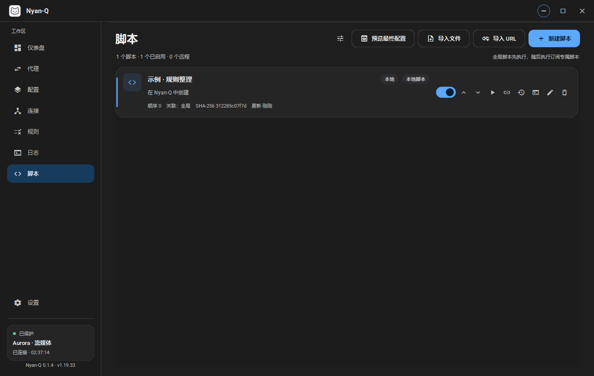
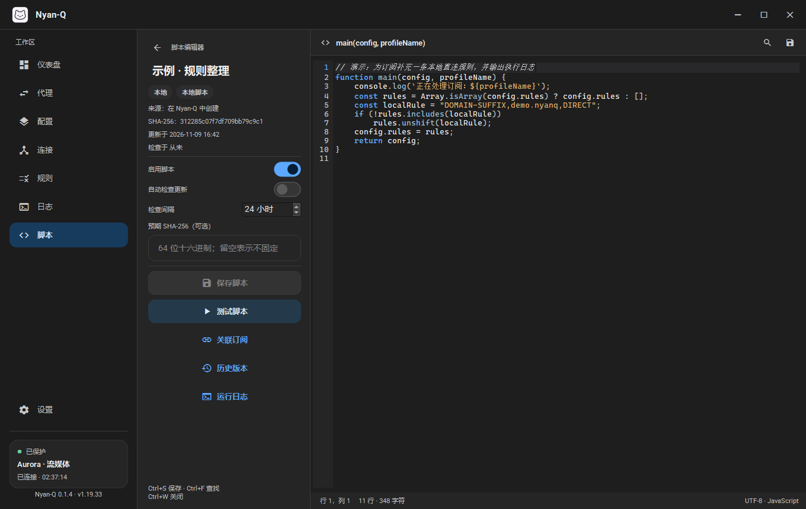
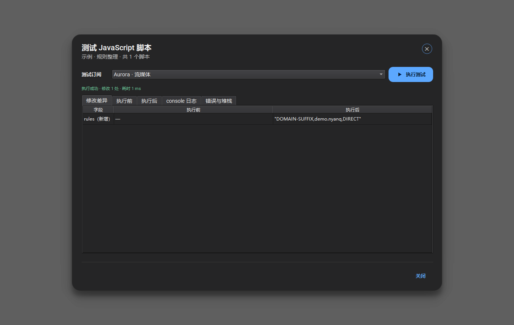

# JavaScript 配置覆写系统

实现日期：2026-11-09 · 适用范围：仅 Mihomo 内核

本文记录 Nyan-Q 现有架构调研、Clash Verge Rev / FlClash 参考实现、
QuickJS 集成方案、模块与数据模型、配置处理流程、安全边界、测试结果和使用方法。

| 脚本列表 | 脚本编辑器 | 测试与差异 |
|:---:|:---:|:---:|
|  |  |  |

---

## 1. 现有项目架构调研

### 1.1 工程与运行时

| 项目 | 现状 |
| --- | --- |
| UI | Qt 6.12 Widgets，C++20，CMake |
| 内核 | Mihomo `v1.19.33`，独立进程，REST API 控制 |
| 配置存储 | `ProfileStore`（`src/core/ProfileStore.*`），`profiles/profiles.json` + YAML 文件 |
| 配置生成 | `RuntimeConfig`（`src/core/RuntimeConfig.*`），逐行文本覆写 |
| 配置加载 | `ClashController::start()` 写 `runtime/config.yaml`，启动 `MihomoProcess` |
| 热重载 | `ClashController::performConfigReload()` 重新生成后调用 `PUT /configs?force=true` |
| 内核检测 | `MihomoProcess` / `MihomoApi`，未使用 `mihomo -t` |
| 测试 | Qt Test，`tests/CMakeLists.txt`，按源文件组合小型测试目标 |
| 依赖 | `scripts/fetch-deps.ps1` 下载 Mihomo/Wintun/libyaml，SHA-256 校验；QuickJS 由 CMake FetchContent 获取；`third_party/` 不入库 |

关键事实：

- `ProfileStore` 只保存**原始订阅**。当前 `RuntimeConfig::build()` 在文本层面删除并重写
  应用自己的顶层字段（端口、`mode`、`log-level`、`ipv6`、`external-controller`、
  `secret`、`tun`），再追加到文件末尾。这是本次必须复用且不能破坏的约束。
- `start()` 与 `performConfigReload()` 都是同步路径；`performConfigReload()` 在主线程
  读写文件后直接发 REST 请求。加入 JS 后必须异步化，且失败不能覆盖上一份有效配置。
- 项目没有 YAML DOM，只有文本处理；没有嵌入式 JS 运行时；没有脚本存储。
- UI 的 Material 3 组件在 `src/ui/widgets/MaterialWidgets.*`；编辑器
  `CodeEditor` 目前硬编码 YAML 高亮，需要扩展为可切换 JavaScript 高亮。
- `--smoke-test` 已覆盖真实内核启动、REST API、热重载、设置热应用和优雅退出，
  适合扩展为端到端脚本验证。

---

## 2. 参考实现

### 2.1 Clash Verge Rev

参考版本：`main` 分支（抓取时 tree `c83f7ad529c7c9cb3d2d54a0955ef8c1b22a411b`）。

| 文件 | 关键实现 |
| --- | --- |
| `src-tauri/src/enhance/script.rs` | Boa 引擎；`main(config, profileName)`；JSON 字符串桥；5 秒超时；1000 条 / 1 MB 日志上限；10 MB 配置上限；`console` 注入；异常/超时后返回原配置 |
| `src-tauri/src/enhance/mod.rs` | 全局合并 → 全局脚本 → 订阅合并 → 订阅脚本；执行后用 `AuthoritativeFields` 重新强制控制面字段；脚本只接收小写字段视图 |
| `src-tauri/src/enhance/merge.rs` | 深度合并，`dns` 浅合并，`hosts` 整体替换 |
| `src-tauri/src/enhance/seq.rs` | 规则/节点/组的 prepend/append/delete，并清理代理组引用 |
| `src-tauri/src/utils/tmpl.rs` | 默认脚本模板 |

可借鉴：

- 统一 `main(config, profileName)` 入口；
- 配置以 JSON 兼容对象传入，脚本返回完整对象；
- console 日志限额、配置大小限额；
- 全局脚本先于订阅脚本；
- 脚本之后重新强制 Nyan-Q 自己拥有的控制面字段，防止脚本劫持控制器；
- 失败时记录脚本名和错误，不提交部分结果。

不直接复用：

- Boa 引擎（体积、与 Qt 集成方向不同；本项目指定 QuickJS）；
- `tokio::time::timeout` 包住阻塞任务的做法：超时后 Boa 任务仍可能继续运行，
  不是真正的执行中断。本项目使用 QuickJS `JS_SetInterruptHandler` 在字节码执行
  与正则匹配中主动中断；
- 将整个配置 key 小写化：会改变用户自定义扩展字段，本项目保留原始大小写和顺序。

### 2.2 FlClash

参考版本：`main` 分支（抓取时 tree `be84736605527034689c95bf27828ff27d912c5e`）。

| 文件 | 关键实现 |
| --- | --- |
| `plugins/rust_api/rust/src/script/mod.rs` | `rquickjs`；10 秒超时；256 MB 内存；`set_interrupt_handler`；独立 `Runtime`/`Context`；`json_parse` / `json_stringify`；Promise 排空 job queue；未完成 Promise 报错 |
| `plugins/rust_api/rust/src/script/console.rs` | 安装 `console.log/info/warn/error/debug/trace`，参数格式化为字符串 |
| `lib/common/javascript.dart` | Dart 侧只传字符串、校验返回值是 Map，不直接接触 QuickJS |

可借鉴：

- 10 秒 / 256 MB 的默认值；
- 每个脚本新建 Runtime；
- 用 QuickJS 自带中断回调实现真正的超时终止；
- Promise job queue 排空；空队列但 Promise pending 时直接报“不会完成”；
- console 仅作为输出接口，不暴露宿主能力；
- 下载成功与执行成功严格区分。

不直接复用：

- Flutter/Dart + Rust FFI 的插件分层；Nyan-Q 使用 Qt/C++ 直接集成；
- 把脚本内容直接拼进 eval 代码（本项目先单独执行脚本，再解析 `main` 标识符，
  避免注入并支持 `const main = ...`）；
- 仅靠 C++ 侧 JSON 序列化返回值（本项目逐值遍历并拒绝函数、Symbol、BigInt、
  NaN/Infinity、循环引用和非普通对象，错误信息带字段路径）。

---

## 3. 总体架构

```text
┌──────────────────────────── UI (Qt Widgets) ────────────────────────────┐
│ ScriptsPage / ScriptEditorView / ScriptDialogs                          │
│  只调用 ScriptManager、ScriptPipeline、ConfigComposer 的公开接口         │
└───────────────┬─────────────────────────────────────────────────────────┘
                │
┌───────────────▼───────────────┐     ┌───────────────────────────────────┐
│ ScriptManager                 │────▶│ ScriptRepository                  │
│ 生命周期 / 元数据 / 更新调度    │     │ scripts.json / 当前文件 / 历史版本 │
│ 绑定解析 / 版本确认与回滚       │     │ QSaveFile 原子写入                │
└───────┬───────────────┬───────┘     └───────────────────────────────────┘
        │               │
        │               ├────────────▶ ScriptDownloader (QNetworkAccessManager)
        │               │               HTTPS / ETag / Last-Modified / 超时 / 大小限制
        │               │
        │               └────────────▶ ScriptLogManager (内存 + JSONL 轮转)
        │
┌───────▼─────────────────────────────────────────────────────────────────┐
│ ClashController                                                         │
│  ProfileStore ──▶ ConfigComposer ──▶ ScriptPipeline ──▶ ScriptEngine     │
│                         │                    │              (QuickJS)     │
│                         │                    └─ 独立 QThread / 每脚本新 Runtime
│                         ▼                                               │
│                  MihomoConfigValidator (`mihomo -t`)                     │
│                         │                                               │
│                         ▼                                               │
│                  原子替换 runtime/config.yaml ──▶ MihomoProcess/REST      │
└─────────────────────────────────────────────────────────────────────────┘
```

模块职责：

| 模块 | 文件 | 职责 |
| --- | --- | --- |
| ScriptEngine | `src/scripts/ScriptEngine.*` | QuickJS 封装、安全执行、超时/内存/异常、console、返回值校验 |
| ScriptPipeline | `src/scripts/ScriptPipeline.*` | 多脚本编排、全局→订阅顺序、客户端设置前后处理、差异、Cancellation |
| ScriptRepository | `src/scripts/ScriptRepository.*` | `scripts.json`、当前内容、历史版本、原子写入、路径校验 |
| ScriptManager | `src/scripts/ScriptManager.*` | CRUD、启停/排序、信任、自动更新、版本确认/回滚、日志 |
| ScriptDownloader | `src/scripts/ScriptDownloader.*` | 条件请求、重定向、超时、大小上限、HTTP 错误 |
| ScriptBindingManager | `src/scripts/ScriptBindingManager.*` | 全局/订阅关联、排除、稳定 ID、顺序解析 |
| MihomoConfigValidator | `src/scripts/MihomoConfigValidator.*` | `mihomo -t -d <data> -f <candidate>` |
| ScriptLogManager | `src/scripts/ScriptLogManager.*` | 运行/更新日志，内存上限 + 1 MB 轮转 |
| ConfigComposer | `src/scripts/ConfigComposer.*` | 串起生成、校验、原子提交、并发合并、取消 |
| YamlDocument | `src/scripts/YamlDocument.*` | libyaml 支撑的顺序保持 DOM、标量类型、锚点/合并键、diff |

---

## 4. 数据模型

存储目录：

```text
%LOCALAPPDATA%\Nyan-Q\scripts\
  scripts.json
  files\script-<id>.js
  versions\<id>\<yyyyMMdd-HHmmss>-<sha12>.js
  script.log
  tmp\
```

`scripts.json`（version 2）：

```json
{
  "version": 2,
  "settings": {
    "timeoutMs": 10000,
    "memoryLimitMb": 256,
    "stopOnError": true,
    "autoUpdateEnabled": false,
    "logRetention": 1000
  },
  "scripts": [
    {
      "id": "stable-uuid",
      "name": "规则整理",
      "description": "",
      "kind": "local|remote",
      "sourcePath": "",
      "url": "https://example.com/script.js",
      "fileName": "script-<id>.js",
      "enabled": true,
      "order": 10,
      "autoUpdate": false,
      "updateIntervalHours": 24,
      "etag": "\"v1\"",
      "lastModified": "Wed, 21 Oct 2015 07:28:00 GMT",
      "clientSha256": "<客户端计算>",
      "expectedSha256": "<用户固定值，可选>",
      "trusted": true,
      "lastError": "",
      "createdAt": "...",
      "updatedAt": "...",
      "lastCheckedAt": "...",
      "versions": [
        { "id": "...", "sha256": "...", "size": 1234, "savedAt": "...",
          "sourceUrl": "...", "note": "远程更新 ...", "current": true }
      ]
    }
  ],
  "bindings": [
    { "scriptId": "...", "profileId": "*", "enabled": true },
    { "scriptId": "...", "profileId": "profile-uuid", "enabled": false }
  ]
}
```

绑定语义：

- `profileId == "*"`：全局关联。
- 全局开启时，订阅记录 `enabled=false` 表示**该订阅排除**；其它订阅不受影响。
- 全局关闭时，订阅记录 `enabled=true` 表示该订阅专属。
- 全局脚本先执行；两组内部按 `order`、名称排序。
- 脚本、订阅均使用稳定 ID；删除订阅时自动清理对应关联。

版本：

- 每次内容变化生成一个历史版本；默认保留 10 个。
- 回滚不会删除历史，而是把旧内容保存为新的当前版本。
- 远程更新先写临时版本/候选内容，校验通过后才提交；提交目录使用 `QSaveFile`。
- 更新后第一次配置生成失败时，`ScriptManager::handlePipelineFailure()` 会自动
  回滚到更新前版本。

---

## 5. 配置处理流程

```text
ProfileStore 原始 YAML
        │
        ▼
RuntimeConfig::build()        ← 应用 Nyan-Q 客户端设置（脚本前基线）
        │
        ▼
YamlDocument::parse()         ← 顺序保持、未知字段保留、锚点/合并键展开
        │
        ▼
全局脚本（按 order）
        │
        ▼
订阅专属脚本（按 order）
        │
        ▼
YamlDocument::dump()
        │
        ▼
RuntimeConfig::build()        ← 再次强制客户端控制面字段
        │
        ▼
结构校验（顶层映射、rules/proxies/groups/dns 类型）
        │
        ▼
MihomoConfigValidator (`mihomo -t`)
        │
        ▼
QSaveFile 原子提交 runtime/config.yaml
        │
        ▼
MihomoProcess 启动 或 REST 热重载
```

关键决策：

1. **始终以 Mihomo 配置对象为操作对象**。YAML 映射/序列/标量完整暴露给 JS，
   未知扩展键原样保留。
2. **原始订阅与最终配置分开存储**。脚本只读取原始内容副本，绝不覆盖 `profiles/`。
3. **客户端字段最后重新应用**。即使脚本修改 `mixed-port`、`external-controller`、
   `secret`、`tun`，最终仍由 `RuntimeConfig::build()` 覆盖。这保持了原有安全策略：
   订阅/脚本不能劫持控制器或改变应用管理的端口。脚本仍可修改 proxies、groups、
   rules、DNS、rule-providers、proxy-providers 和自定义字段。
4. **失败不提交**。默认 `stopOnError=true`：任一脚本失败即终止，不写候选配置。
   用户可显式关闭该策略，失败脚本被跳过，其余结果仍经过结构和 Mihomo 校验。
5. **校验后提交**。候选文件通过 `mihomo -t` 后才原子替换 `runtime/config.yaml`；
   校验失败时上次有效文件保持不变。
6. **UI 线程不做 JS**。`ScriptPipeline` 每次运行创建独立 `QThread`，栈 8 MB；
   主线程只接收结果。

---

## 6. QuickJS 集成

### 6.1 依赖

- 引擎：QuickJS-ng `v0.18.0` `quickjs-amalgam.zip`。
- 获取：CMake `FetchContent`，固定 URL + SHA-256：
  `6C05066A6B62B483E2BA0F83D7A16688C6958182B214BFD693529434CEF84A9E`。
- 离线：`-DFETCHCONTENT_SOURCE_DIR_QUICKJS=<dir>`。
- 构建：`nyanq_quickjs` 静态库；MSVC 使用 `/std:c11 /experimental:c11atomics`。
- 不引入 Node.js、Bun、WebEngine、QtWebEngine 或任何 JS 运行时依赖。

### 6.2 隔离边界

每个脚本：

1. `JS_NewRuntime()`；
2. `JS_SetMemoryLimit(256 MB 默认)`；
3. `JS_SetMaxStackSize(512 KB)`；
4. `JS_SetCanBlock(false)`；
5. `JS_SetInterruptHandler(...)`；
6. `JS_SetModuleLoaderFunc(..., reject)`，动态模块加载一律报错；
7. `JS_NewContext()`，只添加引擎内置对象（Object/Array/JSON/Math/Date/Promise 等）；
8. 只注入 `console`，由 C 函数实现，捕获 quota；
9. 执行脚本、解析 `main`、调用、把返回值逐值转回 YAML DOM；
10. `JS_FreeContext` / `JS_FreeRuntime`。

没有暴露：文件、进程、网络、环境变量、Qt 对象、`require`、`std`、`os`、`print`、
`setTimeout`、`fetch`、`Buffer`、模块加载器。脚本之间不共享 Runtime/Context/全局对象。

### 6.3 超时终止

不是 `std::async` 超时等待。`JS_SetInterruptHandler` 在解释器循环、函数调用、
部分内建操作（包括正则匹配的 `lre_check_timeout`）中被 QuickJS 主动调用。
回调检查：

- `steady_clock` 截止时间；
- 应用取消标志（关闭/停止/重启）；
- 返回 1 时 QuickJS 抛出中断异常并停止执行。

Promise job queue 每轮也检查截止时间。若 Promise 仍 pending 且 job queue 为空，
则没有定时器/I/O 能力可使其完成，直接返回明确错误，而不是无限等待。

### 6.4 Promise

- 同步返回值直接使用。
- `JS_IsPromise()` 为真时循环 `JS_ExecutePendingJob()`，直到 fulfilled/rejected
  或超时。
- `JS_PromiseState()` / `JS_PromiseResult()` 读取最终值。
- rejected 使用 Error 的 message/stack 生成错误。
- 永不完成 Promise 报错：“main() 返回的 Promise 永远不会完成：脚本没有可用的
  定时器、I/O 或网络接口”。

### 6.5 返回值校验

只允许 JSON 兼容数据：

- null / boolean / number / string / array / plain object；
- 函数、Symbol、BigInt、NaN、Infinity、循环引用、非普通对象（Date/Map/Class 实例）
  均拒绝，错误信息带字段路径（如 `proxies[2].name`）；
- 顶层必须是对象；
- 数组中的 `undefined` 转为 null，对象中的 `undefined` 省略（与 JSON 一致）；
- 拒绝后不修改原配置。

### 6.6 线程与生命周期

- `ScriptEngine::execute()` 是同步 C++ 调用，**只能在非 UI 线程调用**；
- `ScriptPipeline` 用 `QThread::create` 启动一次性工作线程，结果通过
  `QMetaObject::invokeMethod` 回到主线程；
- 关闭应用时先置取消标志，QuickJS 中断回调在毫秒级返回；
- 等待线程最多 5 秒，极端情况下才 `terminate()`（仅作为进程退出兜底；
  正常情况下中断回调足够）；
- `ConfigComposer::shutdown()`、`ScriptManager::shutdown()` 均先取消/等待，
  再允许 QObject 销毁，避免跨线程悬空。

### 6.7 辅助进程评估

线程内嵌 QuickJS 没有操作系统级隔离：如果 QuickJS 自身出现内存安全漏洞，
恶意脚本理论上可以突破到宿主进程。当前方案的风险控制依赖：

- QuickJS 是专门为嵌入式/受限环境设计的引擎；
- 暴露面只有一个 C 函数 `console`，无宿主对象；
- 内存/栈/时间上限；
- 不加载模块，无 JIT，无文件/网络 API；
- 远程脚本默认不自动更新，首次导入必须确认 URL。

独立辅助进程能隔离引擎漏洞，但会带来：额外可执行文件分发、IPC 协议与超时、
进程启动延迟（每次执行 30–80 ms）、内存翻倍、崩溃恢复、签名/权限一致性问题。
本项目的脚本是用户主动配置的本地/远程代码，并非任意网页内容；在“引擎级权限最小化
+ 中断/内存限制”满足需求的前提下，线程内嵌是更易维护的折中。若未来需要执行完全
不可信的第三方脚本市场内容，建议增加 `NyanQ-ScriptHost.exe` 辅助进程，并把
`ScriptEngine` 的宿主封装替换为 IPC，流水线/存储/UI 层无需改动。

---

## 7. 远程脚本安全与版本管理

流程：

```text
URL (HTTPS，或回环 HTTP 仅测试)
  │
  ├─ 首次导入：UI 展示完整来源 URL + 信任确认
  ├─ GET If-None-Match / If-Modified-Since
  ├─ 30s 超时、1 MB 上限、最多 5 次重定向、HTTPS→HTTP 降级拒绝
  ├─ 临时内容（内存 + QSaveFile 候选）
  ├─ SHA-256（客户端计算）
  ├─ 与 expectedSha256（用户固定值）比较；不匹配拒绝
  ├─ 与当前 clientSha256 比较；相同则跳过写入
  ├─ QuickJS 语法编译校验
  ├─ 原子提交当前文件 + 历史版本 + scripts.json
  └─ 标记待验证；配置生成成功后确认，失败后自动回滚
```

安全要点：

- **默认关闭自动更新**：全局 `autoUpdateEnabled=false`，每个远程脚本
  `autoUpdate=false`；用户必须两级主动开启。
- 手动“检查更新”始终可用。
- 条件请求减少流量；304 只刷新检查时间。
- 下载失败/HTTP 错误/超时/超限/语法错误都不会删除或替换旧脚本。
- `expectedSha256` 是**用户指定**的完整性锚；`clientSha256` 是客户端下载后计算值，
  两者在 UI 和数据结构中分开显示。
- SHA-256 只证明内容完整性与变化，不证明来源可信；UI 用“来源未确认 / 已确认来源 /
  哈希已固定 / 哈希不匹配”区分。
- 远程脚本被手动编辑后清除 ETag/Last-Modified，下一次检查重新下载；固定哈希不匹配时
  `resolveSteps()` 拒绝执行该脚本。
- 不把“下载成功”当成“执行成功”：语法校验只是第一道；最终配置必须通过
  QuickJS 执行 + 结构校验 + `mihomo -t`。
- 更新后配置生成失败：`handlePipelineFailure()` 自动回滚到更新前版本，并保留上次
  有效运行时配置。

---

## 8. 并发与原子性

- `ScriptRepository` 所有内容/元数据写入使用 `QSaveFile`；版本文件先写，元数据后写；
  元数据提交失败时恢复旧当前文件并删除新版本文件。
- `ScriptManager` 每个 scriptId 同时只允许一个下载；重复请求直接拒绝/提示。
- `ConfigComposer` 同一时间只运行一个构建；构建中到达的请求合并为最新一个。
- `ClashController` 热重载在构建期间用 `m_configReloadInFlight` 串行化，并合并
  重载请求；启动请求有独立 requestId。
- 关闭时先取消下载、脚本线程和校验进程；未提交的候选文件删除。
- 跨线程只传递值类型（`ScriptPipelineResult`、`ScriptStepResult` 等），
  不共享 QuickJS Runtime/Context。
- 脚本存储与订阅存储通过稳定 ID 关联；订阅删除后清理关联。

---

## 9. 测试与验证

自动化测试位于 `tests/`，全部通过 `ctest` 运行：

| 测试 | 覆盖 |
| --- | --- |
| `test_yaml_document` | YAML 类型、顺序、锚点/合并键、特殊字段、未知 tag、diff、多文档错误 |
| `test_language_services` | 内置语言插件注册、YAML/JavaScript 语法诊断、重复键、补全与配置字段补全 |
| `test_code_editor` | 补全弹窗、YAML/JavaScript 补全插入位置、诊断波浪线数据 |
| `test_script_engine` | 单脚本修改、console、语法/运行错误、无限循环超时、取消、内存超限、Promise 成功/失败/永不完成、非法返回值、宿主 API 不存在、只编译校验 |
| `test_script_repository` | 增删改查、历史版本、回滚、保留上限、损坏元数据、路径穿越 |
| `test_script_binding_manager` | 全局/订阅、排除、顺序、共享、清理 |
| `test_script_pipeline` | 多脚本顺序、客户端字段覆盖、失败终止、跳过策略、差异/日志、异步线程、结构校验、完整性错误 |
| `test_script_downloader` | 成功、ETag/Last-Modified 条件请求、304、HTTP 500、超时、超大响应、URL 限制、并发同脚本 |
| `test_script_manager` | 本地持久化、多订阅绑定、远程导入、304/哈希未变、固定哈希拒绝、下载失败保留旧版、并发更新、默认关闭自动更新、失败自动回滚、关闭时保留旧脚本、语法错误拒绝、未确认来源拒绝 |
| `test_mihomo_config_validator` | `mihomo -t` 接受有效配置、拒绝无效配置、异步校验、缺失内核 |
| `test_config_composer` | 校验后提交、脚本失败保留旧文件、Mihomo 拒绝保留旧文件、跳过校验、并发请求合并 |
| `test_mihomo_load` | 脚本生成配置后实际启动 Mihomo 并确认加载成功 |

另有端到端手工/CI 冒烟（`--smoke-test`）扩展为：

- 启动前创建一个全局脚本，插入 `DOMAIN-SUFFIX,script.invalid,DIRECT`；
- 脚本配置经 `mihomo -t` 校验后启动内核；
- 订阅保存触发热重载，脚本再次执行；
- 最终断言规则同时包含 `smoke.invalid` 与 `script.invalid`，内核 PID 保持不变，
  优雅退出。

本机测试结果（Release / MSVC 19.44 / Qt 6.12.0 / Windows 11）：

```text
100% tests passed, 0 tests failed out of 15
```

冒烟结果：

```text
SMOKE_OK ... processStable=1 settingsHotApply=1 ruleApplied=1 scriptApplied=1
SMOKE_SHUTDOWN_OK gracefulLog=1 forced=0
```

---

## 10. 构建与依赖变更

`CMakeLists.txt`：

- `project(... LANGUAGES C CXX)`（libyaml / QuickJS 为 C）；
- `include(FetchContent)` + `FetchContent_Declare(quickjs ...)`；
- `nyanq_quickjs`、`nyanq_yaml`、`nyanq_scripting` 静态库；
- `NyanQ` 和测试链接 `nyanq_scripting`；
- QuickJS C11 atomics、libyaml 版本头、MSVC UTF-8 选项。

`scripts/fetch-deps.ps1`：

- 新增 libyaml 0.2.5 下载与 SHA-256 校验；
- 安装到 `third_party/libyaml`。

`third_party/`、`tools/` 仍然不入库；首次构建运行 `fetch-deps.ps1`，CMake 自动下载
QuickJS。打包脚本无需额外步骤。

---

## 11. 使用

### 11.1 新建与关联

1. **脚本** → **新建脚本**，输入名称。
2. 在编辑器写 `function main(config, profileName) { ... return config; }`。
3. **保存脚本**。
4. **关联订阅**：全局或按订阅勾选；取消全局后可按订阅单独启用。
5. **测试脚本**：选择订阅，查看差异、执行前后 YAML、console 日志和错误堆栈。
6. 运行中的内核会在保存/启停/排序/关联变化后重新生成并热重载。

### 11.2 导入

- **导入文件**：本地 `.js`，保存为本地脚本。
- **导入 URL**：HTTPS（回环地址可用 HTTP），必须勾选来源确认；下载成功且语法
  校验通过后才会创建脚本。默认不自动更新。

### 11.3 远程更新

- 卡片“刷新”或编辑器“检查更新”手动检查。
- 设置页可开启全局自动更新；每个远程脚本还需单独开启。
- 更新前会显示来源 URL、最后更新、当前 SHA-256、检查时间。
- 更新成功后可查看旧/新内容差异；历史版本可回滚。

### 11.4 脚本示例

示例位于 `examples/scripts/`：

- `01-add-local-rules.js`：补充本地规则和 rule-provider；
- `02-filter-proxies.js`：过滤节点并清理代理组引用；
- `03-dns-fake-ip.js`：统一 DNS / fake-ip 过滤；
- `04-async-main.js`：异步 Promise 入口。

最小示例：

```js
function main(config, profileName) {
    console.log("profile:", profileName);
    config.rules = config.rules || [];
    if (!config.rules.includes("DOMAIN-SUFFIX,example.com,DIRECT")) {
        config.rules.unshift("DOMAIN-SUFFIX,example.com,DIRECT");
    }
    return config;
}
```

---

## 12. 安全边界与已知限制

### 12.1 边界

- **不是操作系统沙箱**：QuickJS 运行在桌面进程的线程内。阻止的是 JS 层面的
  文件/网络/进程/模块能力，不是内存安全漏洞。
- 远程脚本首次导入必须确认来源；自动更新默认关闭。
- SHA-256 不等于“可信来源”；用户固定哈希与客户端计算哈希分开。
- 脚本不能修改 Nyan-Q 管理的控制面字段（端口、controller、secret、TUN 等）；
  最终由客户端设置重新覆盖。
- 最终配置必须通过 `mihomo -t` 才提交；失败保留旧配置。
- 脚本执行不在 UI 线程；UI 不接触 Runtime/Context。
- 脚本不能通过 `import()` 绕过限制：模块加载器被禁用。

### 12.2 已知限制

- YAML 注释、锚点/别名写法和手工排版在脚本生效后会丢失；所有字段、值、顺序和
  自定义扩展键保留。
- 顶层客户端字段的脚本修改会被覆盖（这是有意的安全策略）。
- 内存上限统计 QuickJS 堆，不包含宿主 C++ 对象/线程栈；线程栈固定 8 MB。
- QuickJS 编译阶段的中断检查弱于执行阶段；通过 512 KB 脚本大小限制降低风险，
  极端恶意源码仍可能让工作线程长时间占用（UI 不受影响，关闭时兜底终止）。
- `mihomo -t` 的耗时取决于配置规模与磁盘；默认 20 秒超时。
- 远程脚本只能下载 `.js` 文本；不会执行 TypeScript、ESM 模块或 npm 依赖。
- 不支持多内核配置转换（本功能仅 Mihomo）。
- 进程隔离方案未实现，取舍见 6.7。

---

## 13. 后续可扩展项

- 可选 `NyanQ-ScriptHost.exe` 辅助进程（IPC 替换 ScriptEngine 后端）。
- 脚本市场/签名来源，但必须保留固定哈希与信任状态分离。
- 更细粒度的字段级权限（例如只允许修改 DNS/规则）。
- 统一 diff 视图（目前为修改前后并排/表格 + 差异表）。
